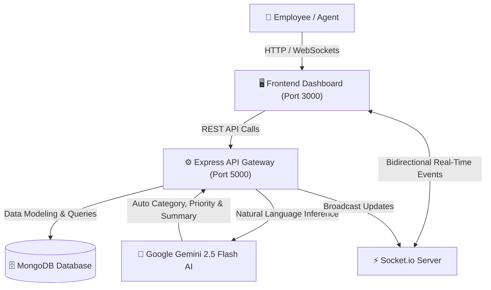

<div align="center">

# ⚡ POWERGRID AI Helpdesk
### Enterprise-Grade Smart IT Ticketing & Management System

[](https://nodejs.org/)
[](https://expressjs.com/)
[](https://www.mongodb.com/)
[](https://socket.io/)
[](https://ai.google.dev/)
[](LICENSE)

An intelligent, real-time enterprise IT Service Management (ITSM) and ticketing platform built to streamline IT operations, automate ticket classification, and deliver real-time collaboration between employees and IT support teams.

[Features](#-key-features) • [Tech Stack](#-tech-stack) • [Architecture](#-system-architecture) • [Quick Start](#-quick-start) • [API Reference](#-api-endpoints) • [Project Structure](#-project-structure)

---

</div>

## 📖 Overview

**POWERGRID AI Helpdesk** is designed for high-efficiency enterprise environments. It eliminates manual triage bottlenecks by integrating **Google Gemini AI** to automatically analyze user issue descriptions, categorize tickets, evaluate incident priorities, and generate executive summaries. Combined with **Socket.io** real-time event broadcasting, support teams receive instant updates without refreshing pages.

---

## ✨ Key Features

### 🤖 Gemini AI-Powered Automation
- **Smart Auto-Categorization**: Analyzes natural language descriptions and intelligently tags tickets under `access`, `hardware`, `software`, `network`, `email`, or `other`.
- **Intelligent Priority Scoring**: Automatically recommends priority tiers (`low`, `medium`, `high`, `critical`) based on urgency and operational impact.
- **Auto-Generated Summaries**: Produces concise professional ticket titles and executive summaries for prompt agent comprehension.
- **Embedded AI Chatbot**: Real-time virtual assistant providing employees with immediate troubleshooting steps and guided resolution workflows.

### 🎫 Comprehensive Ticket Lifecycle
- **End-to-End Status Tracking**: Complete lifecycle management across `Pending`, `Open`, `In Progress`, `Resolved`, `Completed`, and `Closed`.
- **Audit History Log**: Granular chronological tracking of all ticket actions, state transitions, modifications, and user stamps.
- **Enterprise Staff Metadata**: Tracks Employee IDs, department tags, contact details, and assigned engineering squads.

### 👥 Team & Workforce Management
- **Role-Based Access Control**: Tailored portals for standard employees, helpdesk agents, and system administrators.
- **Squad Assignments**: Assign individual engineers or specialized departments to incoming incidents.
- **User Directory & Profiles**: Centralized employee directory with contact details and active incident counts.

### ⚡ Live Real-Time Collaboration
- **Socket.io Engine**: Live sync across all open dashboards when tickets are created, reassigned, or updated.
- **Instant Alerts**: Immediate notification badges for critical priority incidents.

### 📊 Analytics & Reporting
- Visual breakdown of ticket volume by department, priority distribution, and resolution turnaround times.
- Interactive filtering and quick-search across historical tickets.

---

## 🛠️ Tech Stack

| Layer | Technologies |
| :--- | :--- |
| **Frontend** | HTML5, Modern CSS3 (Grid/Flexbox/CSS Variables), Vanilla JavaScript (ES6+), [Lucide Icons](https://lucide.dev/), [IBM Plex Sans](https://fonts.google.com/specimen/IBM+Plex+Sans) & [JetBrains Mono](https://fonts.google.com/specimen/JetBrains+Mono) |
| **Backend** | [Node.js](https://nodejs.org/), [Express 5](https://expressjs.com/), [Socket.io](https://socket.io/) |
| **Database** | [MongoDB](https://www.mongodb.com/) via [Mongoose ODM](https://mongoosejs.com/) (with optimized sharded index structures) |
| **AI Engine** | [Google Gemini 2.5 Flash API](https://ai.google.dev/) (`gemini-2.5-flash`) |
| **Security & Auth** | JWT (`jsonwebtoken`), Password Hashing (`bcryptjs`), CORS |

---

## 🏗️ System Architecture



---

## 🚀 Quick Start

### Prerequisites
- [Node.js](https://nodejs.org/) (v18.0.0 or higher)
- [MongoDB](https://www.mongodb.com/try/download/community) (running locally or MongoDB Atlas connection string)
- [Google Gemini API Key](https://aistudio.google.com/app/apikey)

### 1. Clone the Repository
```bash
git clone https://github.com/nava-07/helpdesk.git
cd helpdesk
```

### 2. Configure Backend Environment
Navigate to the backend directory and set up your environment variables:
```bash
cd helpdesk/backend
cp .env.example .env
```

Open `.env` in your editor and configure:
```env
MONGO_URI=mongodb://localhost:27017/helpdesk
PORT=5000
GEMINI_API_KEY=your_actual_gemini_api_key
JWT_SECRET=your_jwt_secret_key
```

### 3. Install Dependencies
```bash
# Install backend dependencies
cd helpdesk/backend
npm install

# Install root orchestration dependencies
cd ..
npm install
```

### 4. Run the Application
Run both backend and frontend concurrently:
```bash
npm start
```
Or start each service independently:
```bash
# Terminal 1: Start Backend (Port 5000)
cd helpdesk/backend
npm run dev # or node server.js

# Terminal 2: Start Frontend (Port 3000)
cd helpdesk/frontend
python -m http.server 3000
```

Access the application in your browser:
- **Web App**: [http://localhost:3000](http://localhost:3000)
- **Backend API**: [http://localhost:5000](http://localhost:5000)

---

## 📁 Project Structure

```text
helpdesk/
├── .gitignore
├── README.md
└── helpdesk/
    ├── package.json               # Concurrently orchestration scripts
    ├── backend/
    │   ├── .env.example           # Environment template
    │   ├── package.json           # Backend dependencies & scripts
    │   ├── server.js              # Express app & Socket.io server entry
    │   ├── config/
    │   │   └── db.js              # MongoDB Mongoose connection
    │   ├── middleware/
    │   │   └── authMiddleware.js  # JWT authentication verification
    │   ├── models/
    │   │   ├── Category.js        # Ticket category definitions
    │   │   ├── Team.js            # Helpdesk team squads
    │   │   ├── Ticket.js          # Core ticket schema & history logs
    │   │   └── User.js            # User accounts & employee metadata
    │   └── routes/
    │       ├── auth.js            # Authentication (signup, login)
    │       ├── categoryRoutes.js  # Category endpoints
    │       ├── gemini.js          # AI chat & auto-categorization
    │       ├── teams.js           # Team squad management
    │       ├── tickets.js         # Ticket CRUD & status updates
    │       └── users.js           # User administration
    └── frontend/
        ├── index.html             # Main Helpdesk dashboard & portal
        ├── login.html             # Employee & agent sign-in
        ├── chatbot.html           # Dedicated AI helpdesk chatbot
        ├── Team-management.html   # IT support team roster & dispatch
        ├── analytics.html         # Performance metrics & reports
        ├── configuration.html     # System & department settings
        ├── profile.html           # User profile & credentials
        └── assets/
            └── team-management.css
```

---

## 📡 API Endpoints

### 🔐 Authentication (`/api/auth`)
| Method | Endpoint | Description |
| :--- | :--- | :--- |
| `POST` | `/api/auth/register` | Register a new user account |
| `POST` | `/api/auth/login` | Authenticate user and receive JWT token |

### 🤖 Gemini AI (`/api/gemini`)
| Method | Endpoint | Description |
| :--- | :--- | :--- |
| `POST` | `/api/gemini/chat` | Contextual AI chat assistant for IT queries |
| `POST` | `/api/gemini/categorize` | Automatically categorizes, prioritizes, and titles an issue description |

### 🎫 Tickets (`/api/tickets`)
| Method | Endpoint | Description |
| :--- | :--- | :--- |
| `GET` | `/api/tickets` | Retrieve all tickets (supports filtering by status & priority) |
| `POST` | `/api/tickets` | Create a new ticket (triggers Socket.io broadcast) |
| `GET` | `/api/tickets/:id` | Fetch ticket details including action history |
| `PUT` | `/api/tickets/:id` | Update ticket status, assignment, or priority |
| `DELETE` | `/api/tickets/:id` | Remove a ticket record |

### 👥 Teams & Users (`/api/teams`, `/api/users`)
| Method | Endpoint | Description |
| :--- | :--- | :--- |
| `GET` | `/api/teams` | List all IT support teams and member rosters |
| `POST` | `/api/teams` | Create a new specialized department squad |
| `GET` | `/api/users` | List registered employees and support personnel |

---

## 🔒 Security Best Practices

- **Sanitized Credentials**: Environment files containing database secrets and API keys are ignored by `.gitignore`.
- **Hashed Passwords**: Password storage leverages salted `bcryptjs` hashing.
- **JWT Authorization**: Sensitive endpoints are protected by bearer token middleware.

---

## 🤝 Contributing

Contributions, bug reports, and feature suggestions are welcome!
1. Fork the Project
2. Create your Feature Branch (`git checkout -b feature/AmazingFeature`)
3. Commit your Changes (`git commit -m 'Add some AmazingFeature'`)
4. Push to the Branch (`git push origin feature/AmazingFeature`)
5. Open a Pull Request

---

## 📄 License

This project is open-source and available under the [MIT License](LICENSE).

<div align="center">
  <sub>Developed with ❤️ for enterprise IT operations by <a href="https://github.com/nava-07">nava-07</a></sub>
</div>
